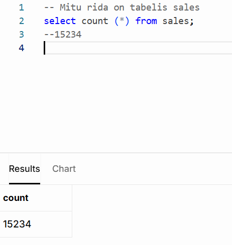
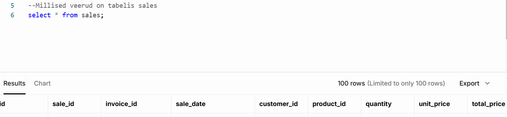
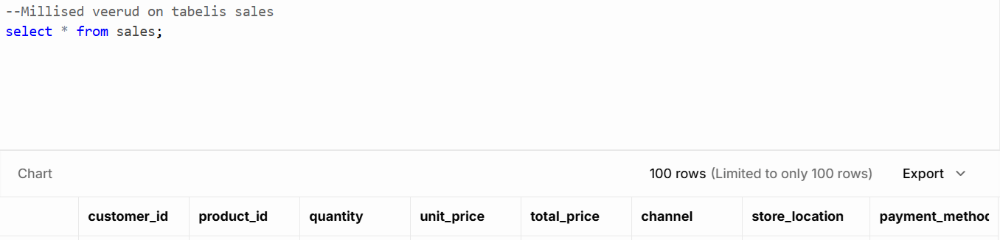
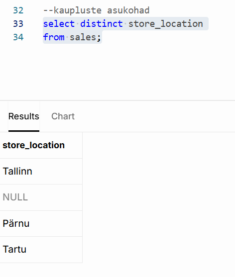
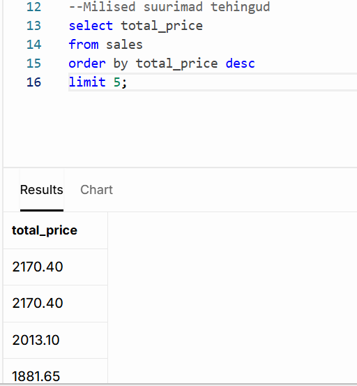
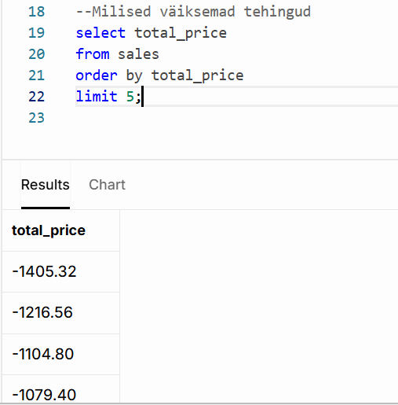
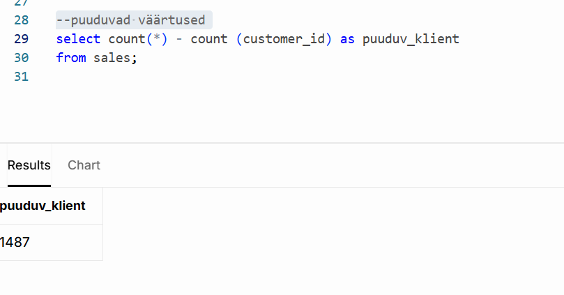

# Nädal 1: SQL Basics

#Roll A - Müügiandmete uurija

Tabelis Sales oli kokku 15234 rida (erineva id-ga müüki)

olid esindatud linnadest Tallinn, Pärnu, Tartu
              
müügiandmetest puudusid kliendi andmed 1487 korral

Päringute sql koodid leiab week-1.sql failist

Mõned näited päringutest ja tulemused:

Mitu rida on tabelis:

Millised veerud on tabelis:

Kaupluste asukohad:

Suurimad ja väiksemad tehingud:

Puuduvad kliendiandmed

